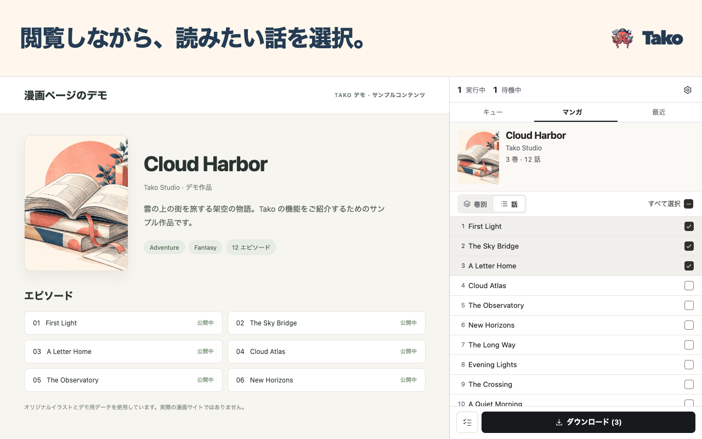

# Tako 漫画ダウンローダー

**漫画のダウンロードを、ブラウザで。**

Chrome のサイドパネルで話を選んでダウンロード。保存中も閲覧を続けられます。

  

[クイックスタート](https://github.com/oovz/Tako/wiki/Quick-Start.ja)

[English](README.md) · [简体中文](README.zh-CN.md) · [繁體中文](README.zh-TW.md) · [日本語](README.ja.md) · [한국어](README.ko.md)

## 読みたい話をまとめて保存

Chrome のサイドパネルから、複数の作品のエピソードをまとめてキューに追加できます。保存中も閲覧を続けられ、保存した話はオフラインで読めます。

- 📚 **いつものアプリで読める。** CBZ や ZIP、個別の画像として保存できます。CBZ には表紙と、サイトで取得できる話のタイトルや公開日などの ComicInfo メタデータを含められます。
- 📁 **書庫を自動で整理。** **ストレージとファイル**でフォルダやファイル名の仕上がりを確認できます。設定したテンプレートは新しいダウンロードに適用されます。
- 🔄 **サイドパネルでダウンロードを管理。** **キュー**で待機中のタスクを並べ替え、未完了の話を再試行できます。保存済みの話は**最近**で確認できます。

## 好きな作品から始めよう

1. [Chrome ウェブストアから Tako をインストール](https://chromewebstore.google.com/detail/tako-manga-downloader/hlodmckfkmbenkknmailfekehgajpmbb)します。
2. 対応サイトで作品やエピソードのページを開き、Tako アイコンをクリックします。
3. サイドパネルの**マンガ**を開き、保存したい話を選んで**ダウンロード**をクリックします。

初期設定では、エピソードを CBZ 形式で保存します。保存形式や命名ルールは **オプション → ストレージとファイル** で変更できます。

## 対応サイト

開くページや有効化が必要なサイトは、[対応サイトのガイド](https://github.com/oovz/Tako/wiki/Supported-Sites.ja)で確認できます。

対応する漫画サイトをすべて見る

**初期設定で有効**

- pixivコミック（pixiv COMIC）
- 少年ジャンプ＋（Shonen Jump+）
- ManHuaGui（看漫画/漫画柜）
- COMIC熱帯（COMIC nettai）
- MANGA MILLION
- FUHOUSE（香香腐宅）
- Mangago
- MangaNato
- MangaKakalot
- Coolmic
- MANGA Plus by SHUEISHA
- DM5（动漫屋）
- zaimanhua（再漫画）
- copy3000（拷貝漫畫）
- MYCOMIC（我的漫畫）
- mangabz（Māngabz）
- MangaHere
- aimanhua（我爱漫画）

**オプションで有効化**

MangaDex は初期設定では無効です。**オプション → サイト統合**で有効にし、Chrome のサイトへのアクセスを許可してください。

表示言語は、英語、日本語、簡体字中国語、繁体字中国語、韓国語から選べます。

## 困ったときのガイド

[初めてのダウンロード](https://github.com/oovz/Tako/wiki/Quick-Start.ja) · [フォルダとファイル名](https://github.com/oovz/Tako/wiki/Template-Macros.ja) · [ダウンロードのトラブル](https://github.com/oovz/Tako/wiki/Troubleshooting.ja) · [権限について](https://github.com/oovz/Tako/wiki/Permissions.ja) · [プライバシーポリシー（英語）](PRIVACY.md)

[不具合の報告や対応サイトのリクエスト](https://github.com/oovz/Tako/issues/new/choose)を受け付けています。ローカルでのインストールや開発については、[開発者向けガイド（英語）](CONTRIBUTING.md)をご覧ください。
