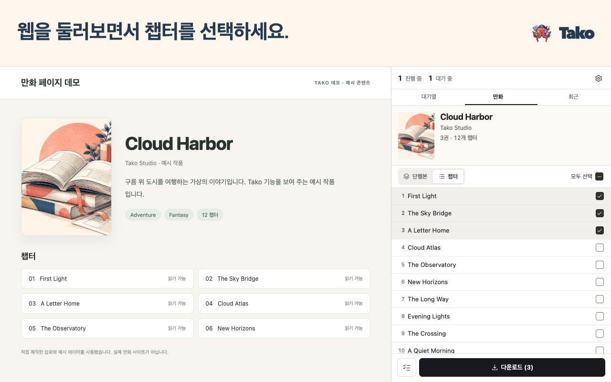

# Tako Manga Downloader

**브라우저에서 바로 만화를 다운로드하세요.**

Chrome 사이드 패널에서 챕터를 고르고, 다운로드하는 동안 웹을 계속 보세요.

  

[빠른 시작](https://github.com/oovz/Tako/wiki/Quick-Start.ko)

[English](README.md) · [简体中文](README.zh-CN.md) · [繁體中文](README.zh-TW.md) · [日本語](README.ja.md) · [한국어](README.ko.md)

## 읽고 싶은 챕터를 보관하세요

Chrome 사이드 패널에서 여러 작품의 챕터를 대기열에 추가할 수 있습니다. Tako가 저장하는 동안 웹을 둘러보고, 저장한 챕터는 오프라인에서 읽으세요.

- 📚 **즐겨 쓰는 앱에서 읽으세요.** CBZ나 ZIP으로 저장하거나 개별 이미지로 보관할 수 있습니다. 만화 뷰어에서 사용할 챕터 정보와 표지를 CBZ에 포함할 수도 있습니다.
- 📁 **라이브러리를 자동으로 정리하세요.** 폴더와 파일 이름 규칙을 정하면 Tako가 챕터를 작품별 폴더에 저장하고 규칙에 따라 이름을 붙입니다.
- 🔄 **다운로드 진행 상황을 확인하세요.** 대기열에서 진행 상황을 보고, 완료하지 못한 챕터를 다시 시도하거나 기록에서 저장한 챕터를 찾을 수 있습니다.

## 좋아하는 작품으로 시작하세요

1. [Chrome 웹 스토어에서 Tako를 설치하세요](https://chromewebstore.google.com/detail/tako-manga-downloader/hlodmckfkmbenkknmailfekehgajpmbb).
2. 지원 사이트에서 작품이나 챕터를 열고 Tako 아이콘을 클릭하세요.
3. 사이드 패널에서 챕터를 선택하고 **다운로드**를 클릭하세요.

Tako는 기본적으로 챕터를 CBZ로 저장합니다. 형식이나 파일 이름 규칙을 바꾸려면 **옵션 → 저장 및 파일**을 여세요.

## 지원 사이트

[지원 사이트 안내](https://github.com/oovz/Tako/wiki/Supported-Sites.ko)에서 어떤 페이지를 열어야 하는지, 옵션에서 먼저 켜야 하는 사이트는 어디인지 확인하세요.

지원하는 만화 사이트 모두 보기

**기본으로 켜진 사이트**

- pixiv Comic (pixivコミック)
- Shonen Jump+ (少年ジャンプ＋)
- Manhuagui (看漫画)
- Comic Nettai (COMIC熱帯)
- MANGA MILLION
- BoyLove (香香腐宅)
- Mangago
- MangaNato
- MangaKakalot
- Coolmic
- MANGA Plus by SHUEISHA
- Anime Manga House (动漫屋)
- Manga Again (再漫画)
- CopyManga (拷貝漫畫)
- MYCOMIC
- Māngabz
- MangaHere
- Love Manga (爱漫画)

**옵션에서 켤 수 있는 사이트**

MangaDex는 기본적으로 꺼져 있습니다. **옵션 → 사이트 연동**에서 켜고 Chrome의 사이트 액세스 요청을 허용하세요.

인터페이스는 영어, 일본어, 중국어 간체, 중국어 번체, 한국어로 제공됩니다.

## 도움이 필요할 때

[첫 다운로드](https://github.com/oovz/Tako/wiki/Quick-Start.ko) · [폴더와 파일 이름](https://github.com/oovz/Tako/wiki/Template-Macros.ko) · [다운로드 문제 해결](https://github.com/oovz/Tako/wiki/Troubleshooting.ko) · [권한](https://github.com/oovz/Tako/wiki/Permissions.ko) · [개인정보 처리방침](PRIVACY.md)

[문제를 제보하거나 사이트 지원을 요청하세요](https://github.com/oovz/Tako/issues/new/choose). 로컬 설치와 개발 방법은 [기여 가이드](CONTRIBUTING.md)를 참고하세요.
