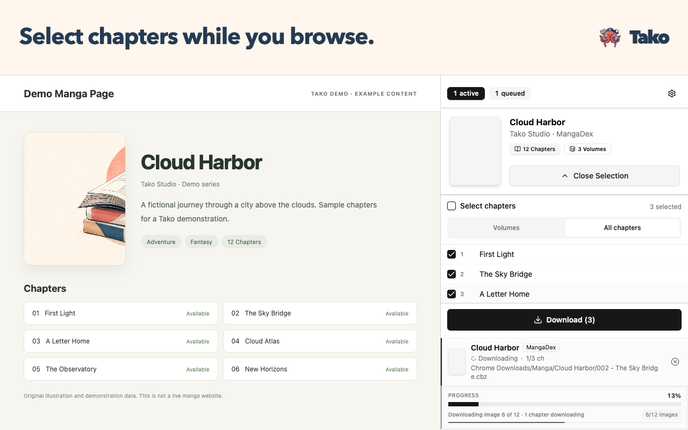

# Tako Manga Downloader

**Manga downloads, right in your browser.**

Queue chapters from Chrome’s side panel and keep browsing while they download.

  

[Quick start](https://github.com/oovz/Tako/wiki/Quick-Start)

[English](README.md) · [简体中文](README.zh-CN.md) · [繁體中文](README.zh-TW.md) · [日本語](README.ja.md) · [한국어](README.ko.md)

## Keep the chapters you want to read

Queue batches of chapters from different series in Chrome’s side panel. Keep browsing while Tako saves them to your library for offline reading.

- 📚 **Read in your favorite app.** Save CBZ or ZIP files, or keep the individual images. CBZ files can include chapter details and cover art for your comic reader.
- 📁 **Organize your library automatically.** Set folder and filename templates so Tako sorts chapters into series folders and names the files as it saves them.
- 🔄 **Track your downloads.** Follow the queue, retry unfinished chapters, and check your history to see what’s ready to read.

## Start with a series you enjoy

1. [Install Tako from the Chrome Web Store](https://chromewebstore.google.com/detail/tako-manga-downloader/hlodmckfkmbenkknmailfekehgajpmbb).
2. Open a series or chapter on a supported site and click the Tako icon.
3. Select your chapters in the side panel, then click **Download**.

Tako saves chapters as CBZ files by default. For other formats and naming options, open **Options → Storage & Files**.

## Supported sites

Check the [supported sites guide](https://github.com/oovz/Tako/wiki/Supported-Sites) to see which page to open and whether you need to enable the site in Options.

See all supported manga sites

**Enabled by default**

- pixiv COMIC (pixivコミック)
- Shonen Jump+ (少年ジャンプ＋)
- ManHuaGui (看漫画/漫画柜)
- COMIC nettai (COMIC熱帯)
- MANGA MILLION
- FUHOUSE (香香腐宅)
- Mangago
- MangaNato
- MangaKakalot
- Coolmic
- MANGA Plus by SHUEISHA
- DM5 (动漫屋)
- zaimanhua (再漫画)
- copy3000 (拷貝漫畫)
- MYCOMIC (我的漫畫)
- mangabz (Māngabz)
- MangaHere
- aimanhua (我爱漫画)

**Optional**

MangaDex is off by default. Enable it in **Options → Site Integrations** and approve Chrome’s site access request.

The interface is available in English, Japanese, Simplified Chinese, Traditional Chinese, and Korean.

## Help

[First download](https://github.com/oovz/Tako/wiki/Quick-Start) · [Folders and filenames](https://github.com/oovz/Tako/wiki/Template-Macros) · [Download help](https://github.com/oovz/Tako/wiki/Troubleshooting) · [Permissions](https://github.com/oovz/Tako/wiki/Permissions) · [privacy policy](PRIVACY.md)

[Report a problem or request a site](https://github.com/oovz/Tako/issues/new/choose). For local installation and development, see the [contributor guide](CONTRIBUTING.md).
