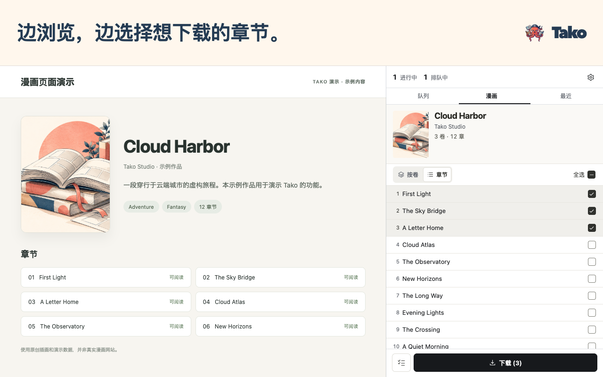

# Tako 漫画下载器

**漫画下载，就在浏览器里。**

在 Chrome 侧边栏选好章节，开始下载后可以继续浏览。

  

[快速入门](https://github.com/oovz/Tako/wiki/Quick-Start.zh-CN)

[English](README.md) · [简体中文](README.zh-CN.md) · [繁體中文](README.zh-TW.md) · [日本語](README.ja.md) · [한국어](README.ko.md)

## 留下想读的章节

在 Chrome 侧边栏把多部漫画的章节分批加入队列。Tako 下载时可以继续浏览，存好后再离线看。

- 📚 **用喜欢的阅读器看。** 保存为 CBZ、ZIP 或单独的图片。CBZ 还可以附上章节信息和封面，供漫画阅读器使用。
- 📁 **自动整理书库。** 设置好文件夹和文件名模板，Tako 保存时会按作品分文件夹，并按你设定的规则给章节文件命名。
- 🔄 **查看下载进度。** 在队列里查看进度，重试没下完的章节，也可以在历史记录里找已保存的章节。

## 从喜欢的作品开始

1. [从 Chrome 应用商店安装 Tako](https://chromewebstore.google.com/detail/tako-manga-downloader/hlodmckfkmbenkknmailfekehgajpmbb)。
2. 在支持的网站打开漫画系列或章节页面，点击 Tako 图标。
3. 在侧边栏中选择章节，点击**下载**。

Tako 默认将章节保存为 CBZ。要更改格式或文件命名规则，请打开**选项 → 存储与文件**。

## 支持的网站

[支持的网站](https://github.com/oovz/Tako/wiki/Supported-Sites.zh-CN)列出了各网站应打开的页面，以及哪些网站需要先在选项中启用。

查看所有支持的漫画网站

**默认启用**

- pixiv Comic（pixivコミック）
- Shonen Jump+（少年ジャンプ＋）
- Manhuagui（看漫画）
- Comic Nettai（COMIC熱帯）
- MANGA MILLION
- BoyLove（香香腐宅）
- Mangago
- MangaNato
- MangaKakalot
- Coolmic
- MANGA Plus by SHUEISHA
- Anime Manga House（动漫屋）
- Manga Again（再漫画）
- CopyManga（拷貝漫畫）
- MYCOMIC
- Māngabz
- MangaHere
- Love Manga（爱漫画）

**按需启用**

MangaDex 默认关闭。请在**选项 → 站点集成**中启用，并同意 Chrome 的网站访问请求。

界面支持英语、日语、简体中文、繁体中文和韩语。

## 需要帮助时

[首次下载](https://github.com/oovz/Tako/wiki/Quick-Start.zh-CN) · [文件夹与文件名](https://github.com/oovz/Tako/wiki/Template-Macros.zh-CN) · [下载问题排查](https://github.com/oovz/Tako/wiki/Troubleshooting.zh-CN) · [权限说明](https://github.com/oovz/Tako/wiki/Permissions.zh-CN) · [隐私政策（英文）](PRIVACY.md)

[报告问题或申请支持新网站](https://github.com/oovz/Tako/issues/new/choose)。本地安装和开发说明请见[贡献指南（英文）](CONTRIBUTING.md)。
