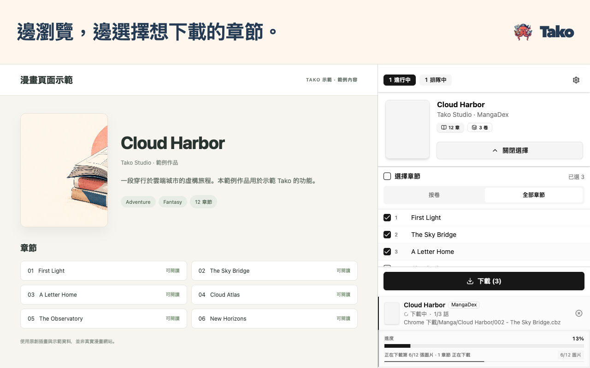

# Tako 漫畫下載器

**漫畫下載，就在瀏覽器裡。**

在 Chrome 側邊面板選好章節，開始下載後就能繼續瀏覽。

  

[快速開始](https://github.com/oovz/Tako/wiki/Quick-Start.zh-TW)

[English](README.md) · [简体中文](README.zh-CN.md) · [繁體中文](README.zh-TW.md) · [日本語](README.ja.md) · [한국어](README.ko.md)

## 收藏想讀的章節

在 Chrome 側邊面板把多部漫畫的章節分批加入佇列。Tako 下載時可以繼續瀏覽，儲存後再離線看。

- 📚 **用喜歡的應用程式閱讀。** 儲存為 CBZ、ZIP 或個別圖片。CBZ 可包含章節資料與封面，供漫畫閱讀器使用。
- 📁 **自動整理書庫。** 設定好資料夾和檔名範本後，Tako 會依作品建立資料夾，並照你設定的規則替章節檔案命名。
- 🔄 **查看下載進度。** 在佇列中查看進度、重試未完成的章節，也能在歷史記錄中找已儲存的章節。

## 從喜歡的作品開始

1. [從 Chrome 線上應用程式商店安裝 Tako](https://chromewebstore.google.com/detail/tako-manga-downloader/hlodmckfkmbenkknmailfekehgajpmbb)。
2. 開啟支援網站上的作品或章節，然後點選 Tako 圖示。
3. 開啟側邊面板的「漫畫」頁，選取章節，再點選「下載」。

Tako 預設將章節儲存為 CBZ。若要變更格式或檔名規則，請開啟「選項 → 儲存與檔案」。

## 支援網站

[支援網站指南](https://github.com/oovz/Tako/wiki/Supported-Sites.zh-TW)列出各網站適用的頁面，以及哪些網站需要先在選項中啟用。

查看所有支援的漫畫網站

**預設啟用**

- pixiv COMIC（pixivコミック）
- Shonen Jump+（少年ジャンプ＋）
- ManHuaGui（看漫画/漫画柜）
- COMIC nettai（COMIC熱帯）
- MANGA MILLION
- FUHOUSE（香香腐宅）
- Mangago
- MangaNato
- MangaKakalot
- Coolmic
- MANGA Plus by SHUEISHA
- DM5（动漫屋）
- zaimanhua（再漫画）
- copy3000（拷貝漫畫）
- MYCOMIC（我的漫畫）
- mangabz（Māngabz）
- MangaHere
- aimanhua（我爱漫画）

**依需求啟用**

MangaDex 預設關閉。請在**選項 → 網站整合**中啟用，並允許 Chrome 存取網站。

介面支援英文、日文、簡體中文、繁體中文與韓文。

## 需要協助時

[第一次下載](https://github.com/oovz/Tako/wiki/Quick-Start.zh-TW) · [資料夾與檔名](https://github.com/oovz/Tako/wiki/Template-Macros.zh-TW) · [下載疑難排解](https://github.com/oovz/Tako/wiki/Troubleshooting.zh-TW) · [權限說明](https://github.com/oovz/Tako/wiki/Permissions.zh-TW) · [隱私權政策](PRIVACY.md)

[回報問題或建議支援網站](https://github.com/oovz/Tako/issues/new/choose)。本機安裝與開發方式，請參閱[貢獻指南](CONTRIBUTING.md)。
