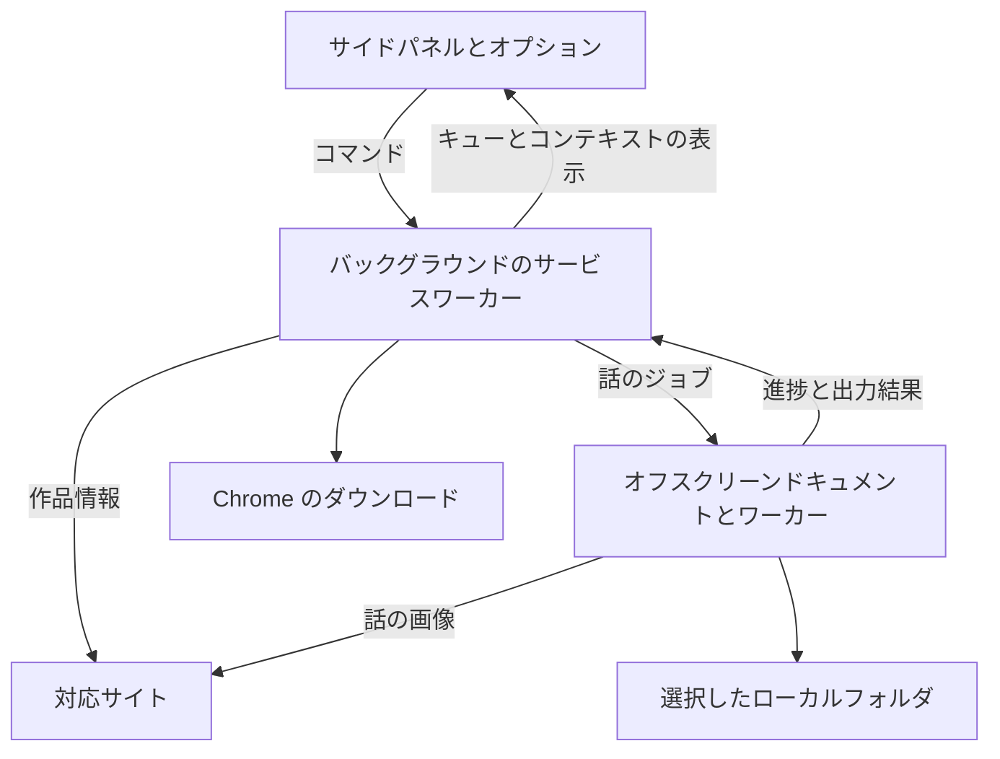

# アーキテクチャ

[English](Architecture) · [日本語](Architecture.ja) · [简体中文](Architecture.zh-CN) · [繁體中文](Architecture.zh-TW) · [한국어](Architecture.ko)

このページは[英語版](Architecture)から機械翻訳されています。

このページは開発者向けです。ダウンロードやフォルダについては、[クイックスタート](Quick-Start.ja)と[トラブルシューティング](Troubleshooting.ja)をご覧ください。

Tako は Chrome 150 以降向けの WXT Manifest V3 拡張機能です。バックグラウンドのサービスワーカーが永続的な処理の調整を担当し、オフスクリーンドキュメントが画像処理とファイルの生成を行います。

## ランタイムの境界



### サイドパネルとオプション

UI は、話の選択、キュー、履歴、設定を表示します。永続データの書き込みを担当するバックグラウンドに、検証済みのコマンドを送信します。セッションストレージの表示用データで画面を更新し、ランタイム Port で実行中タスクの高頻度な進捗を送ります。

作品コンテキストと話の選択は、特定のウィンドウ、タブ、リビジョンに属します。バックグラウンドは、自身が持つ作品スナップショットと選択された話 ID から、ダウンロードの入力を再構成します。

### サービスワーカー

バックグラウンドは Chrome のリスナーを同期的に登録し、準備完了までにスキーマの更新と永続状態の読み込みを終えます。スケジューリング、タスクのコマンド、Chrome のダウンロード、権限、通知、オフスクリーンドキュメントの寿命を管理します。

キューの状態遷移はドメインカーネルで定義し、ストレージリポジトリが確定した後、コーディネーターが副作用を実行します。外部への副作用の前に実行意図と所有権を保存するため、起動時に中断された処理を照合できます。

### オフスクリーンドキュメント

オフスクリーンドキュメントは、話の画像を解決し、サイト固有の変換、アーカイブの作成、選択したフォルダへの書き込みを行います。ランタイムメッセージで、受付、ハートビート、進捗、出力結果を報告します。同梱ワーカーが、適した圧縮処理や画像処理を担当します。

リソース台帳で、使用中の画像バッファー、描画面、保持中の出力に上限を設けます。Chrome がまだ読み取る可能性がある間、Blob の依存リソースを保持します。

### リクエストのスケジューリング

共有 HTTP クライアント、時間制御付き画像転送、Bottleneck のスケジューリングで、サイトのエンドポイントポリシー、リクエスト間隔、同時実行数、キャンセル、再試行を適用します。各サービスインスタンスでは、最初のリクエストが並行して来た場合に初期化を共有します。タスクは作成時に記録したポリシースナップショットを使います。

### ページプローブ

作品情報の解決には、URL のデータ、サイトの API、取得した HTML を使います。実ページの状態が必要な統合機能は、同梱の一回限りのプローブを宣言できます。プローブは読み取り範囲を制限して検証済みのプレーンデータを返し、リソースを解放します。初期設定では分離ワールドで実行します。

## 永続化されたジョブのプロトコル

キューはブラウザプロファイル全体で共有し、実行中のタスクと話のパイプラインはそれぞれ一つです。話の処理試行には、ジョブの識別情報と試行番号があります。

```text
ディスパッチの所有権を保存
  → オフスクリーンジョブを開始
  → 受付、ハートビート、進捗を確認
  → ファイルを生成・保存
  → 話とタスクの結果を確定
  → 所有権を解放し、次の話をスケジュール
```

起動時は、永続記録を現在のオフスクリーンジョブと Chrome のダウンロードに照合します。残っている処理を照合・復旧し、復旧できない処理は中断または未確認として記録します。保存結果が不確かな場合は、利用者が既存ファイルを先に確認できるよう、手動での再試行が必要です。

## 出力のトランザクション

話の成功には、必要なすべての出力について保存が確認されている必要があります。アーカイブや Blob の生成完了は途中段階です。

### Chrome のダウンロード

`chrome.downloads.download()` を呼ぶ前に、バックグラウンドは出力の識別情報と開始状態を保存します。その後、ネイティブのダウンロード ID を記録し、Chrome のイベントと復旧時の照会で最終結果を確認します。

Chrome が保存ダイアログや一時停止中のダウンロードを待っている間、受け付けた転送は保留中のままになる場合があります。成功するには、必要なすべてのファイルが `complete` に達する必要があります。結果を確定できない場合は、重複の可能性を知らせた上で手動の復旧操作を表示します。

キューの確定とリソースの解放は、別々の記録で管理します。ブラウザが Blob を必要としなくなってから解放し、保持中のバイト数はリソース使用量に含めます。

### キャンセル、後片付け、再起動後の復旧

キャンセルでは、タスクの結果を確定してから、生成処理と後続の話のディスパッチを止めます。Chrome が受け付けたダウンロードは、Chrome の管理下で続きます。

生成処理のキャンセルが未確認の場合は、復旧用リースを保持します。起動時と復旧用アラームで、残っている所有権と後片付けを再確認します。継続の副作用は、タスクとネイティブ出力のゲートを解放した後に実行し、確定する試行に結び付けます。

### File System Access

タスクの作成時に、保存先、該当する場合はフォルダハンドル ID、各話の指定パスを記録します。オプションの変更は新しいタスクの既定設定に適用されます。再試行、再実行、取り消しの復元では、タスクの実効保存先と指定パスを保持します。

一つのフォルダハンドル ID は、常に同じディレクトリを参照します。別のフォルダを選ぶと、新しい既定の参照を作ります。既存タスクのアクセス権の更新は、そのタスクの元のフォルダを対象にします。既定設定、受け付け済みの保存、タスク、取り消しの復元、使用中のリースが必要としている間、ハンドルを保持します。

フォルダへの保存の成功には、必要な書き込みとストリームのクローズがすべて完了している必要があります。保存エラーが起きると、タスクを失敗または一部成功で終了し、残りの話をスキップします。保存済みの出力と元の原因を保持します。

Chrome への自動切り替えには、タスクに記録された同意が必要で、初期状態では無効です。最初のファイルシステム変更より前に限り利用できます。切り替えを選ぶと実効保存先を保存し、新しい試行をディスパッチします。その後は、Chrome の最終的な転送結果で成功を判断します。

## タスクと話の結果

| 結果              | 意味                                                             |
| ----------------- | ---------------------------------------------------------------- |
| `completed`       | 必要なすべてのファイルの保存を確認した                           |
| `partial_success` | 一部の出力は保存されたが、要求全体は未完了                       |
| `failed`          | 保存済みと確認された出力がないままタスクが終了した               |
| `canceled`        | 利用者が残りの処理を停止した                                     |
| `skipped`         | キャンセルまたはフォルダの終端エラーの後、その話を処理しなかった |

保存先が保存を確認すると、UI に**保存済み**または**フォルダーに保存済み**と表示します。最終的な保存結果が不明な古い記録は、**以前に処理済み**と表示します。新しい再試行では、新しい出力集計を使います。

## 進捗

進捗は、解決、ダウンロード、変換、アーカイブ、保存という話ごとの段階で表します。個別ファイルの書き込みは画像のダウンロードと並行する場合があります。画像のバッチが終わるまでは、ダウンロード段階を維持します。完了は保存先の結果を待ちます。

## ストレージの担当

| 保存領域                 | 用途                                                         |
| ------------------------ | ------------------------------------------------------------ |
| `chrome.storage.local`   | 設定、キュー、履歴、所有権、出力、マイグレーションの永続記録 |
| `chrome.storage.session` | 再構築可能な UI と進捗の表示用データ                         |
| IndexedDB                | ローカルフォルダのハンドルと保持記録                         |
| React の状態             | ビューの状態と現在の選択内容の下書き                         |

Chrome ストレージの変更は、バックグラウンドがリポジトリを通じて行います。使用中の Blob データはオフスクリーンのメモリに置きます。エピソード履歴はタスク履歴と独立しています。タスクを削除しても話の記録は保持し、明示的な履歴消去では固有の消去基準時刻を記録します。

スキーマのマイグレーションは、永続状態の読み込み前に順番に実行します。永続ジャーナルにより、中断されたステップを記録済みの契約に従って完了してから次へ進めます。マイグレーション層は過去のスキーマを、リポジトリが使う現在のスキーマに変換します。

## サイト統合機能

各サイトの `definition.json` は、識別情報、同梱・有効状態、オリジン、照合ルール、機能、ポリシー、設定を宣言します。ジェネレーターは定義を検証し、コンテキストごとのレジストリとマニフェスト権限を生成します。

統合機能のソースは `src/site-integrations/<id>/`、保存したページやプロトコルのテストベクトルは `tests/fixtures/site-integrations/<id>/` に置きます。任意の `README.md` は、サイト固有の実装を開発者向けに説明する文書です。入力パスはテスト側で、検証記録は実サイトの検証側で管理します。

バックグラウンドの統合機能が作品とディスパッチコンテキストを解決します。オフスクリーンの統合機能がチャプタープランを解決し、画像のダウンロードと変換を行います。実装手順は[サイト統合ガイド](Site-Integration-Guide.ja)をご覧ください。

## エラーと診断の境界

UI は翻訳されたエラー分類を表示します。機密情報を除いた技術的な詳細は、拡張機能の診断に記録します。ログやテスト成果物を共有する際は、サイトの URL、認証情報、ヘッダー、応答本文、ローカルパスの扱いに注意してください。

## ソースの案内

| 領域                             | 参照先                                                                                                                                                                                 |
| -------------------------------- | -------------------------------------------------------------------------------------------------------------------------------------------------------------------------------------- |
| ランタイムの担当                 | [`entrypoints/background/`](https://github.com/oovz/Tako/tree/main/entrypoints/background) と [`entrypoints/offscreen/`](https://github.com/oovz/Tako/tree/main/entrypoints/offscreen) |
| キューの状態遷移                 | [`src/domain/queue/`](https://github.com/oovz/Tako/tree/main/src/domain/queue)                                                                                                         |
| 永続データの書き込み             | [`src/storage/`](https://github.com/oovz/Tako/tree/main/src/storage)                                                                                                                   |
| メッセージ契約とマイグレーション | [`src/runtime/`](https://github.com/oovz/Tako/tree/main/src/runtime)                                                                                                                   |
| サイトのインターフェース         | [`src/types/site-integrations.ts`](https://github.com/oovz/Tako/blob/main/src/types/site-integrations.ts)                                                                              |
| 検証                             | [開発者向けガイド](https://github.com/oovz/Tako/blob/main/CONTRIBUTING.md#testing)                                                                                                     |

## 参考資料

- [Chrome 拡張機能の Manifest V3](https://developer.chrome.com/docs/extensions/mv3/intro/)
- [Chrome サイドパネル API](https://developer.chrome.com/docs/extensions/reference/api/sidePanel)
- [Chrome オフスクリーン API](https://developer.chrome.com/docs/extensions/reference/api/offscreen)
- [Chrome ダウンロード API](https://developer.chrome.com/docs/extensions/reference/api/downloads)
