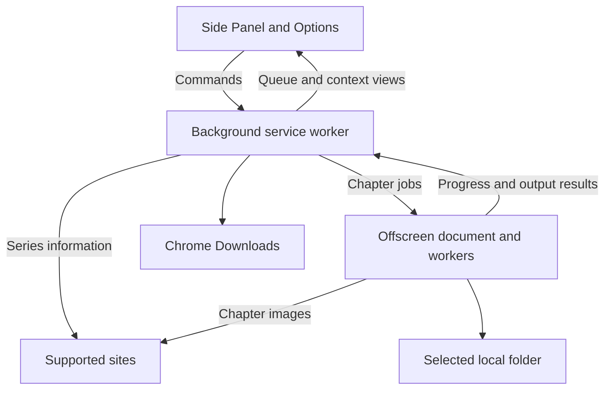

# 아키텍처

[English](Architecture) · [日本語](Architecture.ja) · [简体中文](Architecture.zh-CN) · [繁體中文](Architecture.zh-TW) · [한국어](Architecture.ko)

> 이 페이지는 [영어 원문](Architecture)을 기계 번역한 문서입니다.

이 페이지는 기여자를 위한 문서입니다. 다운로드와 폴더 관련 도움말은 [빠른 시작](Quick-Start.ko)과 [문제 해결](Troubleshooting.ko)을 참고하세요.

Tako는 Chrome 150 이상을 위한 WXT Manifest V3 확장 프로그램입니다. 백그라운드 서비스 워커가 영속적인 작업 조정을 담당하고, 오프스크린 문서가 이미지를 처리하고 파일을 생성합니다.

## 런타임 경계



### 사이드 패널과 옵션

UI는 챕터 선택, 대기열, 기록, 설정을 표시합니다. 검증된 명령을 백그라운드로 보내며 영속적인 쓰기는 백그라운드가 담당합니다. 세션 저장소의 프로젝션이 화면을 최신 상태로 유지하고, 런타임 Port가 자주 갱신되는 진행 중인 작업의 진행 정보를 전달합니다.

작품 컨텍스트와 챕터 선택은 특정 창, 탭, 리비전에 속합니다. 백그라운드는 자체 작품 스냅샷과 선택된 챕터 ID로 다운로드 입력을 재구성합니다.

### 서비스 워커

백그라운드는 Chrome 리스너를 동기적으로 등록한 뒤 준비 상태 경계 안에서 스키마 업그레이드와 상태 복원을 완료합니다. 스케줄링, 작업 명령, Chrome 다운로드, 권한, 알림, 오프스크린 문서 수명을 담당합니다.

대기열 전이는 도메인 커널이 정의하고 저장소 리포지터리가 커밋한 뒤 코디네이터가 후속 효과를 적용합니다. 시작 시 중단된 작업을 조정할 수 있도록 외부 효과를 실행하기 전에 의도와 소유권을 영속화합니다.

### 오프스크린 문서

오프스크린 문서는 챕터 이미지를 확인하고 사이트별 변환을 적용하며 압축 파일을 생성하고 선택한 폴더에 씁니다. 런타임 메시지로 수락, 하트비트, 진행 상황, 출력 결과를 보고합니다. 포함된 워커가 적합한 압축 및 이미지 작업을 처리합니다.

리소스 원장이 사용 중인 이미지 버퍼, 렌더링 표면, 유지된 출력의 양을 제한합니다. Chrome이 Blob을 읽을 수 있는 동안 Blob 의존성은 유지됩니다.

### 요청 스케줄링

공통 HTTP 클라이언트, 시간 제한이 있는 이미지 전송, Bottleneck 스케줄링이 사이트 엔드포인트 정책, 요청 간격, 동시성, 취소, 재시도를 적용합니다. 각 서비스 인스턴스는 동시에 들어온 첫 요청들이 초기화를 공유하도록 합니다. 작업은 생성 시 저장한 정책 스냅샷을 사용합니다.

### 페이지 프로브

작품 정보 확인에는 URL 데이터, 사이트 API 또는 가져온 HTML을 사용합니다. 실제 페이지 상태가 필요한 연동은 확장 프로그램에 포함된 일회성 프로브를 선언할 수 있습니다. 프로브는 범위가 제한된 읽기에서 검증된 일반 데이터를 반환한 뒤 리소스를 해제합니다. 기본 실행 환경은 격리된 월드입니다.

## 영속적인 작업 프로토콜

대기열은 프로필 전체에서 공유하며 활성 작업 하나와 챕터 파이프라인 하나를 사용합니다. 각 챕터 시도에는 작업 식별 정보와 시도 번호가 있습니다.

```text
Persist dispatch ownership
  → start offscreen job
  → observe acceptance, heartbeats, and progress
  → produce and save files
  → commit chapter and task results
  → release ownership and schedule the next chapter
```

시작 시 영속 기록을 현재 오프스크린 작업 및 Chrome 다운로드와 비교합니다. 계속 실행 중인 작업은 조정하고, 복구할 수 없는 작업은 중단 또는 미확인으로 기록합니다. 저장 결과가 불확실한 경우 사용자가 기존 파일을 먼저 확인할 수 있도록 수동 재시도가 필요합니다.

## 출력 트랜잭션

챕터는 필요한 출력이 모두 저장된 것으로 확인될 때 성공합니다. 압축 파일이나 Blob이 준비된 상태는 중간 단계입니다.

### Chrome 다운로드

백그라운드는 `chrome.downloads.download()`를 호출하기 전에 출력 식별 정보와 시작 상태를 영속화합니다. 이후 네이티브 다운로드 ID를 기록하고 Chrome 이벤트와 복구 쿼리로 최종 결과를 확인합니다.

수락된 전송은 Chrome이 저장 대화상자의 응답을 기다리거나 다운로드가 일시 중지된 동안 대기 상태로 남을 수 있습니다. 성공하려면 필요한 모든 파일이 `complete`에 도달해야 합니다. 결과를 확인할 수 없으면 중복 파일 가능성을 안내하며 수동 복구를 제공합니다.

대기열 정산과 리소스 해제는 별도의 기록을 가집니다. 브라우저에서 더 이상 필요하지 않을 때만 Blob을 해제하며, 유지된 바이트는 계속 리소스 사용량에 포함됩니다.

### 취소, 정리, 재시작 복구

취소 시 작업 결과를 먼저 커밋한 뒤 생산자와 이후 챕터 디스패치를 중단합니다. Chrome이 이미 수락한 다운로드는 Chrome의 제어 아래 계속됩니다.

생산자 취소가 확인되지 않으면 복구 임대를 유지합니다. 시작 처리와 복구 알람이 남은 소유권과 정리를 다시 확인합니다. 후속 효과는 작업 및 네이티브 출력 게이트가 해제된 뒤 실행하며, 정산하는 시도에 연결됩니다.

### File System Access

작업 생성 시 저장 위치, 해당하는 경우 폴더 핸들 ID, 각 챕터의 요청 경로를 저장합니다. 옵션은 새 작업의 기본값을 바꿉니다. 재시도, 다시 시작, 실행 취소는 해당 작업의 실제 저장 위치와 요청 경로를 유지합니다.

폴더 핸들 ID는 항상 하나의 디렉터리를 가리킵니다. 다른 폴더를 선택하면 새 기본 참조를 만들고, 기존 작업의 접근 권한을 갱신하면 원래 폴더를 대상으로 합니다. 기본값, 수락된 저장, 작업, 실행 취소, 활성 임대에서 필요로 하는 동안 핸들을 유지합니다.

폴더 저장에 성공하려면 필요한 쓰기와 스트림 닫기가 모두 완료되어야 합니다. 저장 오류가 발생하면 작업을 실패 또는 일부 성공으로 끝내고 남은 챕터를 건너뜁니다. 저장된 출력과 원래 원인을 유지합니다.

Chrome 다운로드로 자동 전환하려면 작업 생성 시 저장한 동의가 필요하며, 기본적으로 꺼져 있습니다. 첫 파일 시스템 변경 전까지만 전환할 수 있습니다. 전환을 선택하면 실제 저장 위치를 영속화하고 새 시도를 디스패치합니다. 이후 Chrome의 최종 전송 결과가 성공 여부를 결정합니다.

## 작업 및 챕터 결과

| 결과              | 의미                                             |
| ----------------- | ------------------------------------------------ |
| `completed`       | 필요한 모든 파일의 저장이 확인됨                 |
| `partial_success` | 일부 출력을 저장했지만 요청 전체가 완료되지 않음 |
| `failed`          | 저장이 확인된 출력 없이 작업이 끝남              |
| `canceled`        | 사용자가 남은 작업을 중단함                      |
| `skipped`         | 취소나 최종 폴더 오류 뒤에 챕터를 처리하지 않음  |

저장 위치에서 저장을 확인하면 UI에 **저장됨** 또는 **폴더에 저장됨**을 표시합니다. 최종 저장 결과를 알 수 없는 이전 기록에는 **이전 처리 기록**을 표시합니다. 새 재시도는 새 출력 집계를 사용합니다.

## 진행 상황

진행 상황은 정보 확인, 다운로드, 변환, 압축, 저장의 챕터 단계에 따라 표시됩니다. 개별 파일 쓰기는 이미지 다운로드와 겹쳐 실행될 수 있으며, 이미지 묶음이 끝날 때까지 다운로드 단계를 유지합니다. 완료 처리는 저장 위치의 결과를 기다립니다.

## 저장소 역할

| 저장소                   | 용도                                                         |
| ------------------------ | ------------------------------------------------------------ |
| `chrome.storage.local`   | 영속적인 설정, 대기열, 기록, 소유권, 출력, 마이그레이션 기록 |
| `chrome.storage.session` | 다시 만들 수 있는 UI 및 진행 상황 프로젝션                   |
| IndexedDB                | 로컬 폴더 핸들과 보존 기록                                   |
| React 상태               | 화면 상태와 현재 선택 초안                                   |

백그라운드는 리포지터리를 통해 Chrome 저장소 변경을 담당합니다. 실제 Blob 데이터는 오프스크린 메모리에 유지합니다. 챕터 기록은 작업 기록과 독립적입니다. 작업을 제거해도 챕터 기록은 유지하고, 명시적으로 기록을 지우면 별도의 삭제 기준 시점을 기록합니다.

스키마 마이그레이션은 상태 복원 전에 순서대로 실행합니다. 영속 저널을 통해 중단된 단계를 기록된 계약에 따라 완료한 뒤 다음 단계로 진행합니다. 마이그레이션 계층은 이전 스키마를 리포지터리가 사용하는 현재 스키마로 변환합니다.

## 사이트 연동

각 사이트의 `definition.json`은 식별 정보, 배포 및 사용 여부, 출처, 매칭 규칙, 기능, 정책, 설정을 선언합니다. 생성기는 정의를 검증하고 컨텍스트별 레지스트리와 매니페스트 권한을 생성합니다.

연동 소스는 `src/site-integrations/<id>/`에, 저장한 페이지와 프로토콜 테스트 벡터는 `tests/fixtures/site-integrations/<id>/`에 둡니다. 선택적인 연동 `README.md`는 기여자에게 사이트별 구현 세부 사항을 설명합니다. 입력 경로는 테스트에서, 검증 기록은 실제 사이트 검사 흐름에서 관리합니다.

백그라운드 연동은 작품과 디스패치 컨텍스트를 확인합니다. 오프스크린 연동은 챕터 계획을 확인하고 이미지를 다운로드하며 변환을 적용합니다. 구현 단계는 [사이트 연동 가이드](Site-Integration-Guide.ko)를 참고하세요.

## 오류 및 진단 경계

UI는 번역된 오류 범주를 표시합니다. 민감 정보를 가린 기술적 세부 사항은 확장 프로그램 진단 정보에 기록합니다. 로그나 테스트 산출물을 공유할 때는 사이트 URL, 인증 정보, 헤더, 응답 본문, 로컬 경로에 주의해야 합니다.

## 소스 안내

| 영역                       | 시작 위치                                                                                                                                                                              |
| -------------------------- | -------------------------------------------------------------------------------------------------------------------------------------------------------------------------------------- |
| 런타임 역할                | [`entrypoints/background/`](https://github.com/oovz/Tako/tree/main/entrypoints/background) 및 [`entrypoints/offscreen/`](https://github.com/oovz/Tako/tree/main/entrypoints/offscreen) |
| 대기열 전이                | [`src/domain/queue/`](https://github.com/oovz/Tako/tree/main/src/domain/queue)                                                                                                         |
| 영속적인 쓰기              | [`src/storage/`](https://github.com/oovz/Tako/tree/main/src/storage)                                                                                                                   |
| 메시지 계약과 마이그레이션 | [`src/runtime/`](https://github.com/oovz/Tako/tree/main/src/runtime)                                                                                                                   |
| 사이트 인터페이스          | [`src/types/site-integrations.ts`](https://github.com/oovz/Tako/blob/main/src/types/site-integrations.ts)                                                                              |
| 검증                       | [기여 가이드](https://github.com/oovz/Tako/blob/main/CONTRIBUTING.md#testing)                                                                                                          |

## 참고 자료

- [Chrome 확장 프로그램 Manifest V3](https://developer.chrome.com/docs/extensions/mv3/intro/)
- [Chrome 사이드 패널 API](https://developer.chrome.com/docs/extensions/reference/api/sidePanel)
- [Chrome 오프스크린 API](https://developer.chrome.com/docs/extensions/reference/api/offscreen)
- [Chrome 다운로드 API](https://developer.chrome.com/docs/extensions/reference/api/downloads)
