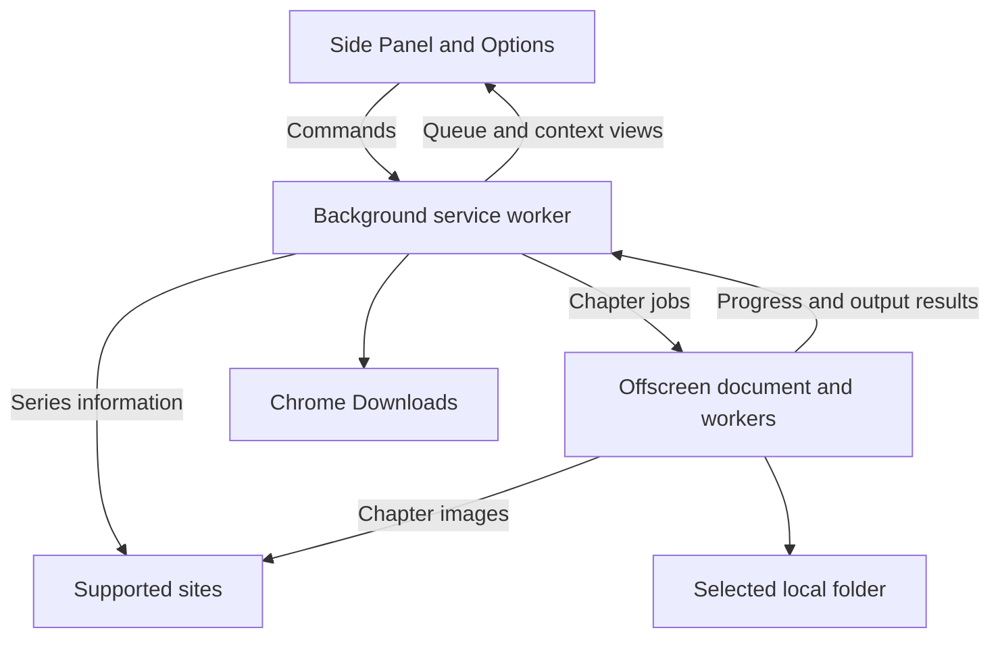

# Architecture

[English](Architecture) · [日本語](Architecture.ja) · [简体中文](Architecture.zh-CN) · [繁體中文](Architecture.zh-TW) · [한국어](Architecture.ko)

This page is for contributors. For download and folder help, see [Quick Start](Quick-Start) and [Troubleshooting](Troubleshooting).

Tako is a WXT Manifest V3 extension for Chrome 150 or newer. The background service worker owns durable coordination; an offscreen document processes images and produces files.

## Runtime boundaries



### Side Panel and Options

The UI presents chapter selection, the queue, history, and settings. It sends validated commands to the background, which owns durable writes. Session-storage projections keep views current; a runtime Port carries frequent active-task progress.

Series context and chapter selections belong to a particular window, tab, and revision. The background reconstructs download input from its own series snapshot and the selected chapter IDs.

### Service Worker

The background registers Chrome listeners synchronously, then completes schema upgrades and hydration behind readiness. It owns scheduling, task commands, Chrome Downloads, permissions, notifications, and the offscreen document's lifetime.

Queue transitions are defined in the domain kernel, committed by storage repositories, and followed by coordinator effects. Intent and ownership are persisted before external effects so startup can reconcile interrupted work.

### Offscreen document

The offscreen document resolves chapter images, applies provider transforms, creates archives, and writes to selected folders. It reports acceptance, heartbeats, progress, and output results through runtime messages. Bundled workers handle suitable compression and image work.

Resource ledgers bound live image buffers, render surfaces, and retained output. Blob dependencies remain alive while Chrome may still read them.

### Request scheduling

The shared HTTP client, timed image transport, and Bottleneck scheduling apply provider endpoint policies, request spacing, concurrency, cancellation, and retries. Each service instance shares initialization for concurrent first requests. Tasks use their captured policy snapshot.

### Page probe

Series resolution uses URL data, provider APIs, or fetched HTML. Integrations that need live page state can declare a bundled one-shot probe. Probes return validated plain data from a bounded read, then release their resources. Isolated-world execution is the default.

## Durable job protocol

The queue is profile-wide, with one active task and one chapter pipeline. A chapter attempt has a job identity and attempt number.

```text
Persist dispatch ownership
  → start offscreen job
  → observe acceptance, heartbeats, and progress
  → produce and save files
  → commit chapter and task results
  → release ownership and schedule the next chapter
```

Startup compares durable records with the current offscreen job and Chrome downloads. Surviving work is reconciled; work that cannot be recovered is recorded as interrupted or unconfirmed. An uncertain save requires a manual retry so the user can check for existing files first.

## Output transaction

A chapter succeeds when all required output has confirmed saving. An archive or Blob being ready is an intermediate step.

### Chrome Downloads

Before calling `chrome.downloads.download()`, the background persists the output identity and initiation state. It then records the native download ID and observes terminal results through Chrome events and recovery queries.

An accepted transfer can remain pending while Chrome waits on a save dialog or a paused download. Every required file must reach `complete` for success. When the result cannot be established, the task exposes manual recovery with a possible-duplicate warning.

Queue settlement and resource release have separate records. A Blob is released only when the browser no longer needs it; retained bytes remain part of resource accounting.

### Cancellation, cleanup, and restart recovery

Cancellation commits the task outcome before stopping the producer and future chapter dispatch. Downloads already accepted by Chrome continue under Chrome's control.

Unconfirmed producer cancellation retains its recovery lease. Startup and recovery alarms revisit outstanding ownership and cleanup. Continuation effects run after task and native-output gates are released, and are bound to the attempt they settle.

### File System Access

Task creation captures a destination, its folder-handle ID when applicable, and each chapter's requested path. Options changes defaults for new tasks. Retry, Restart, and Undo retain the task's effective destination and requested paths.

A folder-handle ID always refers to one directory. Choosing a replacement creates a new default reference; renewing access for an existing task addresses its original folder. Handles remain retained while defaults, accepted saves, tasks, Undo, or active leases need them.

Folder success requires all required writes and stream closures. A saving error ends the task as failed or partially successful and skips remaining chapters. Saved output and the original cause are retained.

Automatic Chrome fallback requires consent captured with the task and is off by default. It is eligible only before the first filesystem mutation. Selecting fallback persists the effective destination and dispatches a fresh attempt. Chrome's final transfer result then determines success.

## Task and chapter outcomes

| Outcome           | Meaning                                                                   |
| ----------------- | ------------------------------------------------------------------------- |
| `completed`       | All required files have confirmed saves                                   |
| `partial_success` | Some output was saved, but the request is incomplete                      |
| `failed`          | The task ended without confirmed saved output                             |
| `canceled`        | The user stopped remaining work                                           |
| `skipped`         | A chapter was not processed after cancellation or a terminal folder error |

The UI shows **Saved** or **Saved to folder** after the destination confirms saving. Older records with an unknown final save result appear as **Previously processed**. A fresh retry has fresh output accounting.

## Progress

Progress follows chapter phases: resolution, downloading, transformation, archiving, and saving. Loose-file writes can overlap image downloading; that downloading phase continues until the image batch finishes. Completion waits for the destination result.

## Storage ownership

| Store                    | Purpose                                                                    |
| ------------------------ | -------------------------------------------------------------------------- |
| `chrome.storage.local`   | Durable settings, queue, history, ownership, output, and migration records |
| `chrome.storage.session` | Rebuildable UI and progress projections                                    |
| IndexedDB                | Local folder handles and retention records                                 |
| React state              | View state and current selection drafts                                    |

The background owns Chrome-storage mutations through repositories. Live Blob data stays in offscreen memory. Chapter history is independent of task history: removing a task preserves chapter records, while explicit history clearing records its own cutoff.

Ordered schema migrations run before hydration. A durable journal lets an interrupted step finish under its recorded contract before advancing. The migration layer converts historical schemas to the current schema used by repositories.

## Site integrations

Each site's `definition.json` declares identity, shipped and enabled state, origins, matching rules, capabilities, policies, and settings. The generator validates these definitions and emits context-specific registries and manifest permissions.

Integration source lives in `src/site-integrations/<id>/`; captured pages and protocol vectors live in `tests/fixtures/site-integrations/<id>/`. Optional integration `README.md` files explain site-specific implementation details for contributors. Tests own their input paths; live workflows own verification records.

Background integrations resolve series and dispatch context. Offscreen integrations resolve chapter plans, download images, and apply transforms. See the [Site Integration Guide](Site-Integration-Guide) for the implementation steps.

## Error and diagnostic boundary

The UI presents localized error categories. Redacted technical details go to extension diagnostics. Provider URLs, credentials, headers, response bodies, and local paths require care when sharing logs or test artifacts.

## Source map

| Area                             | Starting point                                                                                                                                                                          |
| -------------------------------- | --------------------------------------------------------------------------------------------------------------------------------------------------------------------------------------- |
| Runtime ownership                | [`entrypoints/background/`](https://github.com/oovz/Tako/tree/main/entrypoints/background) and [`entrypoints/offscreen/`](https://github.com/oovz/Tako/tree/main/entrypoints/offscreen) |
| Queue transitions                | [`src/domain/queue/`](https://github.com/oovz/Tako/tree/main/src/domain/queue)                                                                                                          |
| Durable writes                   | [`src/storage/`](https://github.com/oovz/Tako/tree/main/src/storage)                                                                                                                    |
| Message contracts and migrations | [`src/runtime/`](https://github.com/oovz/Tako/tree/main/src/runtime)                                                                                                                    |
| Provider interfaces              | [`src/types/site-integrations.ts`](https://github.com/oovz/Tako/blob/main/src/types/site-integrations.ts)                                                                               |
| Validation                       | [Contributing](https://github.com/oovz/Tako/blob/main/CONTRIBUTING.md#testing)                                                                                                          |

## References

- [Chrome extensions Manifest V3](https://developer.chrome.com/docs/extensions/mv3/intro/)
- [Chrome side panel API](https://developer.chrome.com/docs/extensions/reference/api/sidePanel)
- [Chrome offscreen API](https://developer.chrome.com/docs/extensions/reference/api/offscreen)
- [Chrome downloads API](https://developer.chrome.com/docs/extensions/reference/api/downloads)
