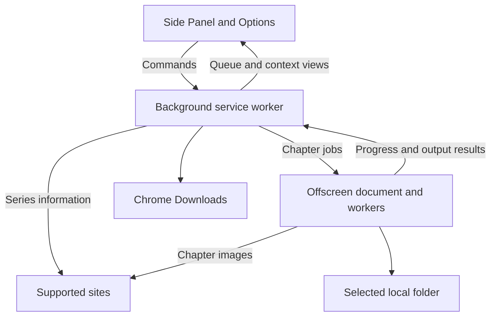

# 架构

[English](Architecture) · [日本語](Architecture.ja) · [简体中文](Architecture.zh-CN) · [繁體中文](Architecture.zh-TW) · [한국어](Architecture.ko)

> 本页由[英文原文](Architecture)机器翻译而来。

本页面向贡献者。下载和文件夹使用帮助见[快速入门](Quick-Start.zh-CN)与[问题排查](Troubleshooting.zh-CN)。

Tako 是基于 WXT 的 Manifest V3 扩展，适用于 Chrome 150 或更新版本。后台 Service Worker 负责持久化协调；离屏文档负责处理图片和生成文件。

## 运行时边界



### 侧边栏与选项

界面展示章节选择、队列、历史和设置，并向后台发送经过验证的命令。后台负责持久化写入。会话存储中的投影视图用于保持界面更新；运行时 Port 传送更新频繁的活动任务进度。

系列上下文和章节选择归属于特定窗口、标签页和修订版本。后台根据自己持有的系列快照及所选章节 ID 重建下载输入。

### Service Worker

后台同步注册 Chrome 监听器，再在就绪屏障内完成数据结构升级和状态恢复。它负责调度、任务命令、Chrome 下载、权限、通知，以及离屏文档的生命周期。

队列转换由领域内核定义，存储仓库提交转换，协调器随后执行相应效果。在产生外部效果之前先持久化意图和所有权，以便启动时协调中断的工作。

### 离屏文档

离屏文档解析章节图片，应用站点所需的变换，创建压缩包，并写入所选文件夹。它通过运行时消息报告接收状态、心跳、进度和输出结果。随扩展打包的 Worker 执行适合的压缩和图片处理工作。

资源账本限制活动图片缓冲区、渲染表面和保留输出的用量。Chrome 仍可能读取 Blob 时，其依赖保持存活。

### 请求调度

共享 HTTP 客户端、带超时控制的图片传输和 Bottleneck 调度共同应用站点端点策略、请求间隔、并发、取消和重试。每个服务实例会让并发的首次请求共用初始化。任务使用创建时捕获的策略快照。

### 页面探针

系列解析使用网址数据、站点 API 或抓取的 HTML。需要实时页面状态的站点集成可以声明一个随扩展打包的一次性探针。探针在有限范围内读取页面，返回经过验证的普通数据，再释放资源。默认在隔离环境中执行。

## 持久化作业协议

队列在整个浏览器配置文件内共享，每次只有一个活动任务和一条章节处理流水线。每次章节尝试都有作业标识和尝试编号。

```text
持久化调度所有权
  → 启动离屏作业
  → 观察接收状态、心跳和进度
  → 生成并保存文件
  → 提交章节和任务结果
  → 释放所有权并调度下一章
```

启动时，将持久化记录与当前离屏作业和 Chrome 下载进行比较。仍在运行的工作会得到协调；无法恢复的工作会记录为中断或未确认。保存结果不确定时，需要手动重试，让用户可以先检查已有文件。

## 输出事务

只有所有必需输出都确认保存后，章节才算成功。压缩包或 Blob 准备就绪属于中间步骤。

### Chrome 下载

调用 `chrome.downloads.download()` 之前，后台先持久化输出标识和启动状态。随后记录原生下载 ID，通过 Chrome 事件和恢复查询观察最终结果。

Chrome 等待保存对话框或下载暂停时，已接收的传输仍可处于等待状态。所有必需文件都达到 `complete` 才算成功。如果无法确认结果，任务会提供手动恢复操作，并提示可能产生重复文件。

队列结算和资源释放各有独立记录。只有浏览器不再需要 Blob 时才释放它；保留的字节仍计入资源用量。

### 取消、清理与重启恢复

取消时先提交任务结果，再停止生产者和后续章节调度。Chrome 已接收的下载继续由 Chrome 控制。

生产者取消结果未确认时，会保留恢复租约。启动流程和恢复闹钟会重新检查尚未解决的所有权和清理工作。后续效果在任务门控和原生输出门控释放后执行，并绑定到它所结算的那次尝试。

### File System Access

创建任务时会捕获保存位置、适用的文件夹句柄 ID，以及每个章节请求的路径。选项修改新任务的默认设置。重试、重新开始和撤销保留任务的实际保存位置及请求路径。

一个文件夹句柄 ID 始终指向同一目录。选择替代文件夹会创建新的默认引用；为现有任务恢复访问权限时，目标仍是该任务原来的文件夹。默认设置、已接受的保存、任务、撤销或活动租约仍需要句柄时，句柄会持续保留。

文件夹保存成功要求所有必需写入及流关闭均成功。保存错误会使任务以失败或部分成功结束，并跳过剩余章节。已保存的输出和原始错误原因会保留。

自动回退到 Chrome 下载需要任务创建时捕获的同意，默认关闭。它只在首次文件系统修改之前符合条件。选择回退会持久化实际保存位置，并发起新的调度尝试。此后由 Chrome 的最终传输结果决定是否成功。

## 任务与章节结果

| 结果              | 含义                                         |
| ----------------- | -------------------------------------------- |
| `completed`       | 所有必需文件均已确认保存                     |
| `partial_success` | 部分输出已保存，但请求尚未完成               |
| `failed`          | 任务结束，且没有确认已保存的输出             |
| `canceled`        | 用户停止了剩余工作                           |
| `skipped`         | 章节在取消任务或终止性的文件夹错误后未被处理 |

保存位置确认保存后，界面显示**已保存**或**已保存到文件夹**。较早且最终保存结果未知的记录显示为**此前已处理**。新的重试会使用新的输出计数。

## 进度

进度遵循章节处理阶段：解析、下载、变换、打包和保存。单独文件的写入可与图片下载重叠；下载阶段会持续到整批图片下载结束。完成状态等待保存位置的结果。

## 存储职责

| 存储                     | 用途                                           |
| ------------------------ | ---------------------------------------------- |
| `chrome.storage.local`   | 持久化设置、队列、历史、所有权、输出和迁移记录 |
| `chrome.storage.session` | 可重建的界面和进度投影                         |
| IndexedDB                | 本地文件夹句柄和保留记录                       |
| React 状态               | 视图状态和当前选择草稿                         |

后台通过仓库负责 Chrome 存储的修改。活动 Blob 数据保留在离屏内存中。章节历史独立于任务历史：移除任务会保留章节记录，显式清除历史则记录自己的截止点。

有序的数据结构迁移在状态恢复前运行。持久化日志让中断的迁移步骤先按其记录的契约完成，再继续后续步骤。迁移层将历史数据结构转换为仓库当前使用的结构。

## 站点集成

每个网站的 `definition.json` 声明标识、打包及启用状态、来源、匹配规则、能力、策略和设置。生成器验证这些定义，并生成各运行上下文的注册表和清单权限。

集成源代码放在 `src/site-integrations/<id>/`，保存的页面和协议测试向量放在 `tests/fixtures/site-integrations/<id>/`。可选的集成 `README.md` 面向贡献者，说明站点特有的实现细节。输入路径由测试管理，验证记录由实际站点检查流程管理。

后台集成解析系列和调度上下文。离屏集成解析章节计划、下载图片并应用变换。实现步骤见[站点集成指南](Site-Integration-Guide.zh-CN)。

## 错误与诊断边界

界面展示本地化的错误类别。经过脱敏的技术细节进入扩展诊断信息。分享日志或测试产物时，需要留意站点网址、凭据、请求头、响应体和本地路径。

## 源码索引

| 区域           | 入口                                                                                                                                                                                   |
| -------------- | -------------------------------------------------------------------------------------------------------------------------------------------------------------------------------------- |
| 运行时职责     | [`entrypoints/background/`](https://github.com/oovz/Tako/tree/main/entrypoints/background) 和 [`entrypoints/offscreen/`](https://github.com/oovz/Tako/tree/main/entrypoints/offscreen) |
| 队列转换       | [`src/domain/queue/`](https://github.com/oovz/Tako/tree/main/src/domain/queue)                                                                                                         |
| 持久化写入     | [`src/storage/`](https://github.com/oovz/Tako/tree/main/src/storage)                                                                                                                   |
| 消息契约和迁移 | [`src/runtime/`](https://github.com/oovz/Tako/tree/main/src/runtime)                                                                                                                   |
| 站点接口       | [`src/types/site-integrations.ts`](https://github.com/oovz/Tako/blob/main/src/types/site-integrations.ts)                                                                              |
| 验证           | [贡献指南](https://github.com/oovz/Tako/blob/main/CONTRIBUTING.md#testing)                                                                                                             |

## 参考资料

- [Chrome 扩展 Manifest V3](https://developer.chrome.com/docs/extensions/mv3/intro/)
- [Chrome 侧边栏 API](https://developer.chrome.com/docs/extensions/reference/api/sidePanel)
- [Chrome 离屏 API](https://developer.chrome.com/docs/extensions/reference/api/offscreen)
- [Chrome 下载 API](https://developer.chrome.com/docs/extensions/reference/api/downloads)
