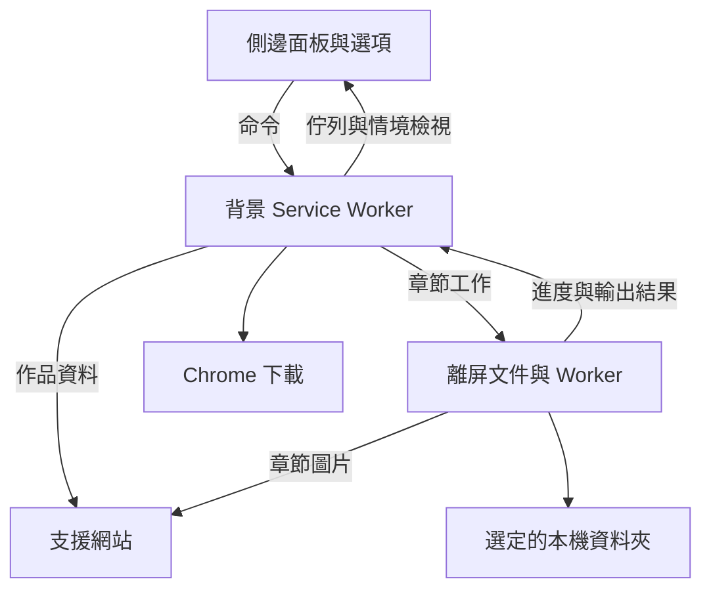

# 架構

[English](Architecture) · [日本語](Architecture.ja) · [简体中文](Architecture.zh-CN) · [繁體中文](Architecture.zh-TW) · [한국어](Architecture.ko)

> 本頁由[英文原文](Architecture)機器翻譯而成。

本頁供貢獻者參閱。下載與資料夾操作說明，請見[快速開始](Quick-Start.zh-TW)與[疑難排解](Troubleshooting.zh-TW)。

Tako 是使用 WXT 建置的 Manifest V3 擴充功能，適用於 Chrome 150 或更新版本。背景 Service Worker 負責持久化協調作業；離屏文件負責處理圖片與產生檔案。

## 執行階段邊界



### 側邊面板與選項

介面呈現章節選取、佇列、歷史紀錄與設定。它將通過驗證的命令傳送至背景，由背景負責持久化寫入。工作階段儲存空間中的投影資料會保持檢視更新；執行階段 Port 則傳遞頻繁更新的作用中任務進度。

作品情境與章節選取隸屬於特定視窗、分頁及修訂版本。背景會根據自己持有的作品快照與所選章節 ID，重新組成下載輸入。

### Service Worker

背景同步註冊 Chrome 事件監聽器，再於就緒閘門後方完成結構描述升級與狀態載入。它負責排程、任務命令、Chrome 下載、權限、通知與離屏文件生命週期。

佇列轉換由領域核心定義，由儲存庫提交後，再執行協調器的後續動作。執行外部副作用前，先持久化意圖與所有權，讓啟動程序可對帳中斷的工作。

### 離屏文件

離屏文件解析章節圖片、套用網站轉換、建立封存檔並寫入選定資料夾。它透過執行階段訊息回報接受狀態、心跳、進度與輸出結果。隨擴充功能封裝的 Worker 負責適合分派的壓縮與圖片工作。

資源帳本限制存活的圖片緩衝區、算繪表面與保留輸出。Chrome 仍可能讀取 Blob 時，其相依資源會持續存活。

### 請求排程

共用 HTTP 用戶端、具時限控制的圖片傳輸與 Bottleneck 排程，會套用網站端點原則、請求間隔、並行限制、取消與重試。每個服務執行個體會讓同時發出的首次請求共用初始化作業。任務使用建立時記錄的原則快照。

### 頁面探測

作品解析使用網址資料、網站 API 或擷取的 HTML。需要即時頁面狀態的整合，可宣告隨擴充功能封裝的單次探測。探測會在有界讀取後回傳通過驗證的純資料，再釋放資源。預設在隔離執行環境中執行。

## 持久化工作通訊協定

佇列涵蓋整個瀏覽器設定檔，同時只有一個作用中任務與一條章節處理管線。每次章節嘗試都有工作識別碼與嘗試次數。

```text
持久化分派所有權
  → 啟動離屏工作
  → 觀察接受狀態、心跳與進度
  → 產生並儲存檔案
  → 提交章節與任務結果
  → 釋放所有權並排程下一章
```

啟動時會比對持久化紀錄、目前的離屏工作與 Chrome 下載。仍存在的工作會進行對帳；無法恢復的工作則記錄為中斷或未確認。儲存結果不確定時，需要手動重試，讓使用者可先檢查既有檔案。

## 輸出交易

所有必要輸出均已確認儲存，章節才算成功。封存檔或 Blob 準備完成只是中間步驟。

### Chrome 下載

呼叫 `chrome.downloads.download()` 前，背景會持久化輸出識別碼與啟動狀態。之後記錄原生下載 ID，並透過 Chrome 事件與復原查詢觀察最終結果。

Chrome 等待儲存對話方塊或下載暫停時，已接受的傳輸仍可能處於待處理狀態。每個必要檔案都必須達到 `complete` 才算成功。若無法確立結果，任務會提供手動復原操作，並提醒可能產生重複檔案。

佇列結算與資源釋放分別記錄。只有在瀏覽器不再需要 Blob 時才會釋放；保留的位元組仍納入資源計算。

### 取消、清理與重新啟動後的復原

取消時，會先提交任務結果，再停止產生端與後續章節分派。Chrome 已接受的下載仍由 Chrome 控制並繼續進行。

尚未確認產生端已取消時，會保留其復原租約。啟動程序與復原鬧鐘會重新檢查未釋放的所有權及清理工作。延續動作會在釋放任務與原生輸出閘門後執行，並綁定至它們所結算的嘗試。

### File System Access

建立任務時會記錄目的地、適用的資料夾控制代碼 ID，以及各章節要求的路徑。選項只會變更新任務的預設值。重試、重新開始與復原操作會保留任務的有效目的地及要求路徑。

一個資料夾控制代碼 ID 始終對應同一個目錄。選擇替代資料夾會建立新的預設參照；為現有任務更新存取權時，則針對它原本的資料夾。只要預設值、已接受的儲存、任務、復原操作或作用中的租約仍需要，控制代碼就會保留。

資料夾儲存成功，必須完成所有必要寫入與串流關閉。儲存錯誤會使任務以失敗或部分成功結束，並略過剩餘章節。已儲存輸出與原始原因會保留。

自動改用 Chrome 下載需要在任務中記錄使用者同意，預設關閉。僅在首次檔案系統變更前符合切換條件。選擇切換後，會持久化有效目的地，並分派全新的嘗試。之後由 Chrome 的最終傳輸結果決定是否成功。

## 任務與章節結果

| 結果              | 意義                                   |
| ----------------- | -------------------------------------- |
| `completed`       | 所有必要檔案均已確認儲存               |
| `partial_success` | 已儲存部分輸出，但要求尚未完成         |
| `failed`          | 任務結束，沒有已確認儲存的輸出         |
| `canceled`        | 使用者停止剩餘工作                     |
| `skipped`         | 取消或終止性的資料夾錯誤後，章節未處理 |

目的地確認儲存後，介面會顯示「已儲存」或「已儲存至資料夾」。最終儲存結果未知的舊紀錄會顯示為「先前已處理」。新的重試會使用新的輸出計算紀錄。

## 進度

進度依章節階段呈現：解析、下載、轉換、封存與儲存。個別檔案的寫入可與圖片下載重疊；在整批圖片下載完成前，仍處於下載階段。完成狀態會等待目的地的結果。

## 儲存所有權

| 儲存位置                 | 用途                                           |
| ------------------------ | ---------------------------------------------- |
| `chrome.storage.local`   | 持久化設定、佇列、歷史、所有權、輸出與遷移紀錄 |
| `chrome.storage.session` | 可重建的介面與進度投影                         |
| IndexedDB                | 本機資料夾控制代碼與保留紀錄                   |
| React state              | 檢視狀態與目前的選取草稿                       |

背景透過儲存庫負責 Chrome 儲存空間的變更。存活的 Blob 資料保留在離屏記憶體。章節歷史獨立於任務歷史：移除任務會保留章節紀錄，明確清除歷史則會記錄各自的截止點。

有順序的結構描述遷移會在狀態載入前執行。持久化日誌讓中斷的步驟依其記錄的契約完成後，才繼續前進。遷移層將歷史結構描述轉為儲存庫目前使用的結構描述。

## 網站整合

每個網站的 `definition.json` 宣告識別資料、封裝與啟用狀態、來源、比對規則、能力、原則與設定。產生器會驗證定義，並輸出各執行環境使用的登錄表與資訊清單權限。

整合原始碼放在 `src/site-integrations/<id>/`，擷取的頁面與通訊協定測試向量放在 `tests/fixtures/site-integrations/<id>/`。選用的整合 `README.md` 面向貢獻者，說明網站特有的實作細節。輸入路徑由測試管理，驗證記錄由實際網站檢查流程管理。

背景整合解析作品與分派情境；離屏整合解析章節計畫、下載圖片並套用轉換。實作步驟請參閱[網站整合指南](Site-Integration-Guide.zh-TW)。

## 錯誤與診斷邊界

介面會呈現本地化的錯誤類別。經遮蔽的技術詳細資料會寫入擴充功能診斷。分享記錄或測試產物時，請留意網站網址、憑證、標頭、回應本文與本機路徑。

## 原始碼導覽

| 範圍           | 起點                                                                                                                                                                                   |
| -------------- | -------------------------------------------------------------------------------------------------------------------------------------------------------------------------------------- |
| 執行階段所有權 | [`entrypoints/background/`](https://github.com/oovz/Tako/tree/main/entrypoints/background) 與 [`entrypoints/offscreen/`](https://github.com/oovz/Tako/tree/main/entrypoints/offscreen) |
| 佇列轉換       | [`src/domain/queue/`](https://github.com/oovz/Tako/tree/main/src/domain/queue)                                                                                                         |
| 持久化寫入     | [`src/storage/`](https://github.com/oovz/Tako/tree/main/src/storage)                                                                                                                   |
| 訊息契約與遷移 | [`src/runtime/`](https://github.com/oovz/Tako/tree/main/src/runtime)                                                                                                                   |
| 網站介面       | [`src/types/site-integrations.ts`](https://github.com/oovz/Tako/blob/main/src/types/site-integrations.ts)                                                                              |
| 驗證           | [貢獻指南](https://github.com/oovz/Tako/blob/main/CONTRIBUTING.md#testing)                                                                                                             |

## 參考資料

- [Chrome 擴充功能 Manifest V3](https://developer.chrome.com/docs/extensions/mv3/intro/)
- [Chrome 側邊面板 API](https://developer.chrome.com/docs/extensions/reference/api/sidePanel)
- [Chrome 離屏 API](https://developer.chrome.com/docs/extensions/reference/api/offscreen)
- [Chrome 下載 API](https://developer.chrome.com/docs/extensions/reference/api/downloads)
